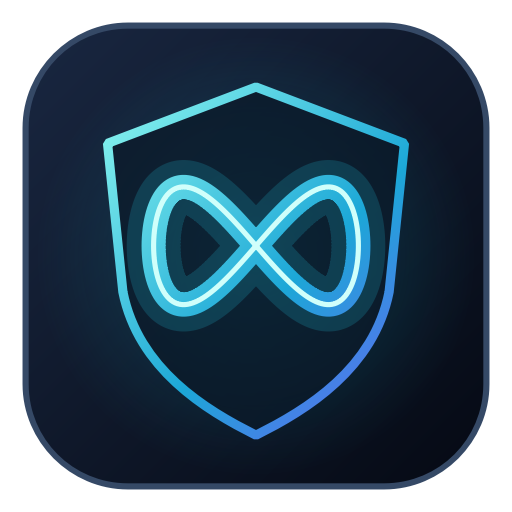
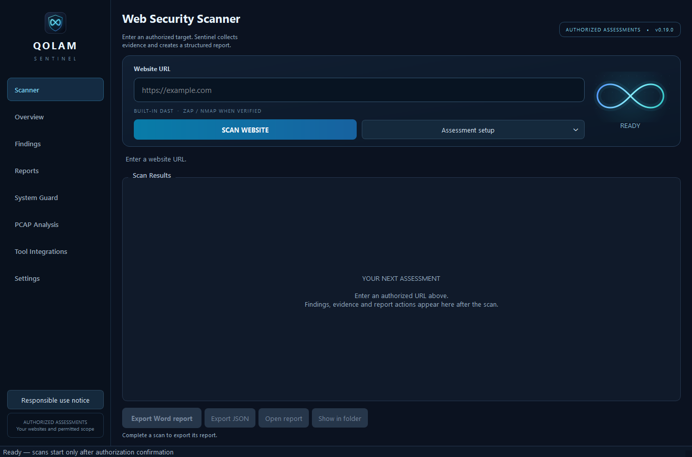

<p align="center"></p>
<h1 align="center">Mirage Sentinel — Web Penetration Testing</h1>
<p align="center">A Windows web penetration testing workbench with browser execution evidence and structured reports.</p>
<p align="center">
<a href="https://github.com/III85III/mirage-sentinel-penetration-testing/releases/tag/v0.19.0"><strong>Download Windows</strong></a> ·
<a href="docs/USER_GUIDE_EN.md">User guide</a> ·
<a href="docs/SECURITY_MODEL.md">Security model</a> ·
<a href="https://github.com/III85III/mirage-sentinel-penetration-testing/issues/new/choose">Report a bug</a>
</p>
<p align="center">
<a href="https://github.com/III85III/mirage-sentinel-penetration-testing/actions/workflows/windows.yml"></a>


<a href="LICENSE"></a>
</p>

**0.19.0 release candidate** · English interface · Persian Word reports and structured JSON · Runs on your computer

Sentinel helps assessors review websites they own or are explicitly authorized to test, including public websites. Enter a URL, run the assessment and review findings with their source, confidence and evidence.



## Start in three steps

1. Download `III85III_MIRAGE_SENTINEL_0.19.0_Windows-x64.zip` from [Releases](https://github.com/III85III/mirage-sentinel-penetration-testing/releases/tag/v0.19.0).
2. Extract the **whole** ZIP. Keep `_internal` beside `Qolam_Sentinel.exe`.
3. Run `Qolam_Sentinel.exe`, enter your authorized website URL and select **Scan Website**.

Python is not required for the portable package. Browser confirmation requires a normally installed, signed Microsoft Edge or Google Chrome. Nmap and OWASP ZAP are separate optional products.

Verify the download with `SHA256SUMS_0.19.0.txt`. The package includes matching application source, collected dependency licenses and per-file hashes.

## Assessment capabilities

| Area | Current behavior |
|---|---|
| Website review | Bounded same-origin crawl, transport, headers, cookies, selected exposures, CORS and query-input checks |
| Browser XSS confirmation | A unique benign computation must execute in the main document before an eligible reflected-input finding becomes validated |
| OpenAPI / Swagger | Import OpenAPI 3.0/3.1 or Swagger 2.0 JSON; discover unlinked API routes and assess documented GET inputs |
| Session and access expectations | Compare explicit read-only paths using a primary test session, optional second account and anonymous access |
| Optional local engines | Origin-scoped ZAP integration and Nmap checks on ports 80, 443, 8080 and 8443 when available |
| Report import | Supported Nuclei JSON/JSONL, SARIF, JSON and Nmap-compatible XML, with source provenance |
| Reporting | Assessment-linked Word/JSON exports, evidence status, remediation and visible incomplete coverage |

Use **Assessment setup** for session rules or an API definition. Supplied sessions stay in memory and are not forwarded to browser XSS checks, ZAP or Nmap.

### Evidence has a status

- **Validated:** observed native browser execution proof or an assessor's recorded validation; inspect the method and evidence.
- **Scanner reported / potential:** a candidate requiring further validation.
- **Not tested / inconclusive:** a coverage gap or unsuccessful check, never a declaration of safety.

The website engine covers up to 25 same-origin pages and ten query parameters. The API engine attempts up to 20 concrete GET operations and ten query parameters. Each engine has a three-candidate browser budget. Limits and actual request counts are recorded.

Stored/blind XSS, exhaustive DOM analysis, POST/JSON execution and full business-workflow testing are outside the current automated coverage. A clean scan does not establish that a website is secure. See the [security model](docs/SECURITY_MODEL.md).

## Verification

The local Windows source suite passed **227 tests**. Packaged verification exercised five API/Word scenarios, three browser scenarios and four supplied-session scenarios against disposable loopback servers.

The frozen application generated and reopened real DOCX files, persisted findings and exported JSON. Executing XSS was distinguished from encoded and CSP-blocked input. Recorded requests were compared with server-observed requests.

[Verification record](docs/verification/VERIFICATION_0.19.0.json) · [Release notes](docs/RELEASE_NOTES_0.19.0.md) · [Release checklist](docs/RELEASE_CHECKLIST.md)

This is an unsigned release candidate. Clean-machine compatibility, completed visual Word layout review and an independent security audit are not claimed.

## Privacy and authorized use

Use Sentinel only within your written authorization and agreed scope. Active probes can affect a target. The responsible-use notice does not grant target access.

Scan history and reports remain on the computer. There is no Sentinel cloud analysis or telemetry service. Optional online speech sends selected text to Microsoft's speech service only after confirmation; local Windows SAPI remains available.

## Run from source

Requires Windows x64 and Python 3.11:

```powershell
py -3.11 -m venv .venv
.\.venv\Scripts\python.exe -m pip install -r requirements-dev.txt
.\.venv\Scripts\python.exe main.py
```

Run `.\.venv\Scripts\python.exe -m pytest tests -q`. Browser integration checks need a signed system Edge/Chrome.

## Build

```powershell
.\.venv\Scripts\python.exe -m pip install -r requirements-build.txt
.\.venv\Scripts\python.exe build_exe.py
.\.venv\Scripts\python.exe package_release.py
```

Packaging refuses to overwrite an existing version. Keep the complete onedir runtime together.

## Contribute and report issues

[Contributing](CONTRIBUTING.md) · [Bug reports](https://github.com/III85III/mirage-sentinel-penetration-testing/issues/new/choose) · [Private vulnerability reporting](https://github.com/III85III/mirage-sentinel-penetration-testing/security/advisories/new)

## License

**GPL-3.0-only.** See [LICENSE](LICENSE), [COPYRIGHT](COPYRIGHT) and [third-party notices](THIRD_PARTY_NOTICES.md).
Bundled dependencies retain their respective licenses; optional tools are separately distributed.
