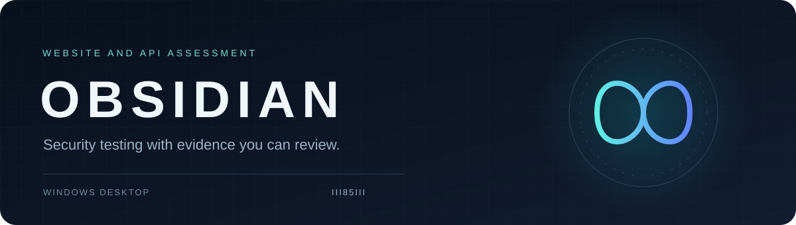
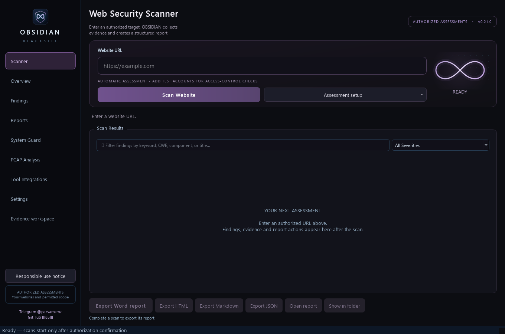

<!-- language-selector:start -->
<p align="center">
<a href="README.md" title="English"></a>
<a href="docs/i18n/README.fa.md" title="فارسی"></a>
<a href="docs/i18n/README.es.md" title="Español"></a>
<a href="docs/i18n/README.fr.md" title="Français"></a>
<a href="docs/i18n/README.de.md" title="Deutsch"></a>
<a href="docs/i18n/README.pt-BR.md" title="Português"></a>
<a href="docs/i18n/README.it.md" title="Italiano"></a>
<a href="docs/i18n/README.ru.md" title="Русский"></a>
<a href="docs/i18n/README.zh-CN.md" title="简体中文"></a>
<a href="docs/i18n/README.ja.md" title="日本語"></a>
<a href="docs/i18n/README.ko.md" title="한국어"></a>
<a href="docs/i18n/README.ar.md" title="العربية"></a>
<a href="docs/i18n/README.hi.md" title="हिन्दी"></a>
<a href="docs/i18n/README.bn.md" title="বাংলা"></a>
<a href="docs/i18n/README.ur.md" title="اردو"></a>
<a href="docs/i18n/README.tr.md" title="Türkçe"></a>
<a href="docs/i18n/README.id.md" title="Bahasa Indonesia"></a>
<a href="docs/i18n/README.vi.md" title="Tiếng Việt"></a>
<a href="docs/i18n/README.th.md" title="ไทย"></a>
<a href="docs/i18n/README.pl.md" title="Polski"></a>
</p>
<!-- language-selector:end -->

<p align="center"></p>

<p align="center"><a href="https://github.com/III85III/attack-website-tools/releases/tag/v0.21.0"><strong>Download for Windows</strong></a> · <a href="docs/USER_GUIDE_EN.md">User guide</a> · <a href="docs/OBSIDIAN_AUDIT.md">Technical coverage</a></p>

# OBSIDIAN

**A Windows desktop workspace for authorized website and API penetration testing, evidence review and client reports.**

OBSIDIAN brings the assessment workflow into one application: enter the website URL, discover reachable application components, run the available security checks, inspect how each result was obtained, and export the selected assessment as a Word, HTML, Markdown or JSON report. It is intended for security researchers, penetration testers and developers assessing websites they own or have permission to test.

The application combines its own bounded web scanner with JavaScript and API discovery, optional browser verification, explicitly configured test-account comparisons and existing external-tool integrations. Its purpose is to make both the findings and the gaps visible: a reported suspicion, an observed configuration and a reproduced vulnerability are different results.



*The actual 0.21 Windows application. The evidence workspace uses saved assessment data; local fixture verification is documented in the audit.*

## What the scanner checks

| Area | Actual behavior |
|---|---|
| Pages and input points | Crawls a bounded set of same-origin pages and records forms, query parameters, scripts and their relationships. Preserves parameter case and available form defaults. |
| JavaScript and source maps | Finds literal API routes, exposed structured source maps, credential-shaped values and a limited set of local source-to-sink candidates. Sensitive values are redacted. Static candidates do not establish runtime exploitability. |
| Reflected XSS | Examines reflected input and its HTML context. Eligible candidates can be checked in an isolated browser using a harmless computed marker; matching execution evidence is required for browser-confirmed results. |
| Database errors | Compares the original input, a harmless control and repeated quote responses. A new repeatable database signature is reported as potential error disclosure, not automatically as proven SQL injection. |
| Template evaluation | Uses independent harmless arithmetic challenges to identify reproducible evaluation indicators. It does not infer command execution or full exploit impact from arithmetic alone. |
| HTTP configuration | Checks security headers, cookie attributes, controlled CORS origin responses, selected exposure paths, redirect behavior and supported header-injection indicators. |
| API definitions | Discovers or imports supported OpenAPI/Swagger JSON, reviews declarations and performs bounded anonymous GET checks. A declaration/response mismatch alone does not prove private data access. |
| Access-control expectations | With supplied synthetic accounts and declared resources, compares identity baselines, anonymous access and repeated unexpected access against the assessor's expected rules. Ownership and roles must be supplied explicitly. |

File-boundary testing is available through explicitly declared synthetic canary options in the engine. It requires a provisioned harmless file and expected marker; automatic sensitive-system-file reads are not used. This option currently has no dedicated setup screen.

## BLACKSITE 0.21

Use **Assessment setup** to import HAR route metadata, configure synthetic account comparisons or explicitly approve a small resilience sample. HAR import is offline and removes captured credentials, values and bodies. Discovery-only is the default; approved synthetic GET probes run through the existing scanner and never replay captured sessions. Authenticated, ownership-sensitive and state-changing captured requests remain discovery-only.

**Evidence workspace** shows the saved discovery graph, route coverage, SQL-error hypotheses, timeline and finding confidence. Counts distinguish discovery, collection and checks; legacy scans with no ledger show unknown coverage. The graph contains observed discovery links, not fabricated exploit chains.

Redirect verification now uses four controlled comparisons and two independent destinations. Destinations are never followed. Session checks revalidate the primary identity before recording unexpected access. Resilience sampling is separately approved, serial, capped at 20 requests and 2 requests/second, and stops on errors, latency, backpressure or high client memory. It is not a capacity or DDoS test.

Creator: [GitHub III85III](https://github.com/III85III) · [Telegram @parsamzmz](https://t.me/parsamzmz). Both links are also in the application footer.

## From URL to report

1. **Choose the authorized target.** Enter its base URL and confirm the scope. The main screen uses one **Scan Website** action; optional test-account, API, HAR and controlled resilience setup is in **Assessment setup**.
2. **Map the application.** The native collector discovers the reachable surface and records which pages, scripts and routes led to each observation. Discovery does not authorize testing another hostname.
3. **Run applicable checks.** Baselines, control responses, request limits and available verification methods determine what can actually be tested. Missing prerequisites remain visible as skipped, blocked or inconclusive coverage.
4. **Inspect the evidence.** Filter the results and open a finding to review its endpoint, source, severity, confidence, verification status and remediation. Severity describes potential impact; confidence describes evidence strength.
5. **Export the assessment.** Select Word, HTML, Markdown or JSON. Reports remain linked to the selected scan and its recorded engine runs, rather than mixing unrelated targets.

Native collection is bounded, uses response-size limits and does not follow redirects automatically. The stop control requests cancellation, and native HTTP 429/503 responses stop further collection. An optional engine already running may finish its bounded operation before cancellation is handled.

## What is in the report

The report starts with the target, assessment timing, execution status and an executive summary based on saved results. Findings include their affected endpoint or component, source tool, severity and its basis, confidence, verification state, sanitized evidence and remediation. Recorded prerequisites, numbered reproduction guidance and demonstrated impact are included when present in the evidence; missing proof is not invented.

Coverage sections distinguish operations that completed from checks that were skipped, blocked, failed or remained inconclusive. Exact duplicate records are consolidated. If no finding is recorded as validated, Word states that explicitly. A report can still contain useful configuration observations or candidates that require review.

**Word, HTML and Markdown** support readable delivery and review; **JSON** retains structured assessment records for further processing. Before sharing any report, check the target, imported evidence and confidentiality requirements. Redaction is applied, but imported descriptions and customer-specific details still deserve human review.

## Install and run

Use **Windows x64**. The portable build includes Python's runtime, so a separate Python installation is not required.

1. Download **[OBSIDIAN_0.21.0_Windows-x64.zip](https://github.com/III85III/attack-website-tools/releases/download/v0.21.0/OBSIDIAN_0.21.0_Windows-x64.zip)** from the release page.
2. Extract the **entire ZIP** into a writable folder.
3. Open **OBSIDIAN.exe** and keep its `_internal` folder beside it.
4. Read the responsible-use notice, enter the authorized website URL and select **Scan Website**.
5. Review the results and choose **Export Word report**, HTML, Markdown or JSON.

Download [SHA256SUMS_0.21.0.txt](https://github.com/III85III/attack-website-tools/releases/download/v0.21.0/SHA256SUMS_0.21.0.txt) and compare the ZIP hash before use. The release is **unsigned**; a checksum checks integrity and is not a signing certificate. GitHub's automatic source archive is not the runnable Windows application.

## Optional tools and prerequisites

Browser confirmation needs a supported, signed system installation of **Microsoft Edge or Google Chrome**. **OWASP ZAP** can be used through its configured local API, and **Nmap** through the existing bounded host-check adapter when available. Availability is checked and unavailable engines are reported; an executable name or downloaded archive is not treated as proof that a tool works.

Supported scanner exports, including Nuclei JSON/JSONL, SARIF and Nmap-compatible XML, can be imported with source provenance. An imported match remains scanner-reported unless independently verified. Importing a report does not execute that scanner or its payloads. No heavyweight scanner is silently installed.

## Coverage, validation and privacy

Version 0.21.0 verification results are recorded in the [BLACKSITE audit](docs/BLACKSITE_AUDIT.md); CI status should be checked on the matching commit. Local frozen-runtime checks compared recorded requests with server-observed requests and exercised evidence persistence and report generation/reopening. Small labeled fixture corpora measure only the behaviors they contain; they do not establish complete website detection accuracy.

This is an **unsigned release**, not a complete automated replacement for a scoped penetration test. Stored/blind XSS, complete authentication lifecycles, application-specific business workflows and exhaustive dynamic JavaScript analysis remain incomplete or require explicit assessment scenarios. Visual Word page rendering remains unverified. [Read the actual verification record](docs/verification/VERIFICATION_0.21.0.json) and [implementation audit](docs/BLACKSITE_AUDIT.md).

Scan history is stored locally. Requests go from your computer to the selected target; passive certificate-transparency discovery also contacts its provider. Optional online voice sends selected text to its provider after confirmation. Protect credentials, sessions, reports and customer data, and keep them out of public issues. Software availability and the confirmation dialog do not grant permission to test a website.

<details>
<summary><strong>Run from current source and build</strong></summary>

From the repository root, using Python 3.11 on Windows:

```powershell
git clone https://github.com/III85III/attack-website-tools.git
cd attack-website-tools
py -3.11 -m venv .venv
.\.venv\Scripts\python.exe -m pip install -r tools/requirements/runtime.txt
.\.venv\Scripts\python.exe -m src
```

For tests, install `tools/requirements/dev.txt` and run `python -m pytest tools/tests -q` in that environment. For a build, install `tools/requirements/build.txt`, then run `python tools/build_exe.py` and `python tools/package_release.py`. Packaging refuses to overwrite an existing version.

The root contains only this README, the license and three main folders: `src/` for the application, `docs/` for guides and legal notices, and `tools/` for build helpers, tests and dependencies. [Folder and build guide](docs/REPOSITORY_LAYOUT.md). Historical release archives retain their original filenames, paths and checksums.

</details>

[User guide](docs/USER_GUIDE_EN.md) · [Report a bug](https://github.com/III85III/attack-website-tools/issues) · [Security policy](.github/SECURITY.md) · [Contributing](.github/CONTRIBUTING.md)

**GPL-3.0-only.** [License](LICENSE) · [Copyright](docs/legal/COPYRIGHT) · [Third-party notices](docs/legal/THIRD_PARTY_NOTICES.md).
